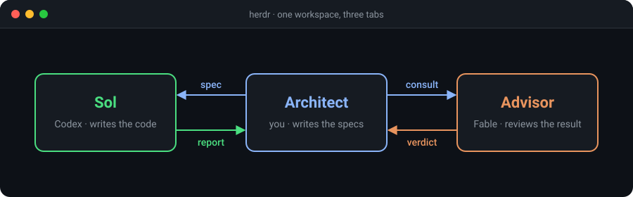

# herdr-architect

A Claude Code skill that turns one session into an architect over two [Herdr](https://herdr.dev) tabs: an implementer and an advisor. The architect writes specs and verifies results but never types implementation code. Every deliverable is reviewed by a second model with a clean context before it is reported done.



## Roles

| Role | Model | Where |
|---|---|---|
| Architect | the session you talk to, any model | your pane: specs, verification, reporting |
| Implementer | GPT-5.6 Sol via Codex CLI | its own tab, sandboxed to the working tree and /tmp |
| Advisor | Fable 5.1 via Claude Code in plan mode | its own tab, read-only, cleared after every consult |

Both tabs stay visible in Herdr while the work runs, so you can watch Sol work or read the advisor's reasoning at any time.

## Flow

1. `setup.sh` runs preflight and opens or reuses both tabs.
2. The architect writes a spec with six fixed parts and sends it to Sol. The call returns as soon as Sol starts working; the architect writes the next spec or the review consult while it does.
3. Sol writes a report file in a fixed format. The architect reads the diff and re-runs the verification itself.
4. The advisor is consulted before architectural commitments, after two failed attempts, and once at the end of every deliverable. It answers in under 300 words and ends with `VERDICT: ship | fix-first | rethink`.
5. `fix-first` goes back to Sol as a numbered list. The architect verifies the fix against that list.
6. `teardown.sh` closes both tabs and the architect reports: outcome, changes, verification, review verdict, open items.

## Requirements

- Claude Code running inside a Herdr tab (`HERDR_ENV=1`)
- `codex` with access to `gpt-5.6-sol`
- `claude` with access to the `fable` model
- `python3`

Tested with Herdr 0.8.2, Codex CLI 0.152.1 and Claude Code 2.1.258.

## Install

```bash
git clone https://github.com/kennethgeerts/herdr-architect ~/.claude/skills/herdr-architect
```

## Use

In a Claude Code session inside Herdr, ask for work "with Sol", "via Codex", or "with the architect pattern", or ask for a Fable review. The session loads the skill and takes it from there.

Sol's reasoning effort is chosen at setup and holds for the tab: `high` by default, or `xhigh`, `max`, `ultra` for harder work. Reports, specs and consults land under `/tmp/herdr-architect/<timestamp>-<slug>/`.

## Files

| File | Purpose |
|---|---|
| `SKILL.md` | the pattern: rules, spec format, command blocks |
| `sol-rules.md` | standing rules and report format, appended to every spec |
| `advisor-prompt.md` | system prompt for the advisor's Claude Code session |
| `setup.sh` | preflight, report directory, tab creation or reuse, trust dialog, env file |
| `teardown.sh` | closes both tabs and removes the env file; reports stay under `/tmp` |

## Credits

A simplified take on [DannyMac180/fable-advisor](https://github.com/DannyMac180/fable-advisor), collapsed from a two-lane `codex exec` wrapper into something visible and interactive inside Herdr.

## License

[MIT](LICENSE)
